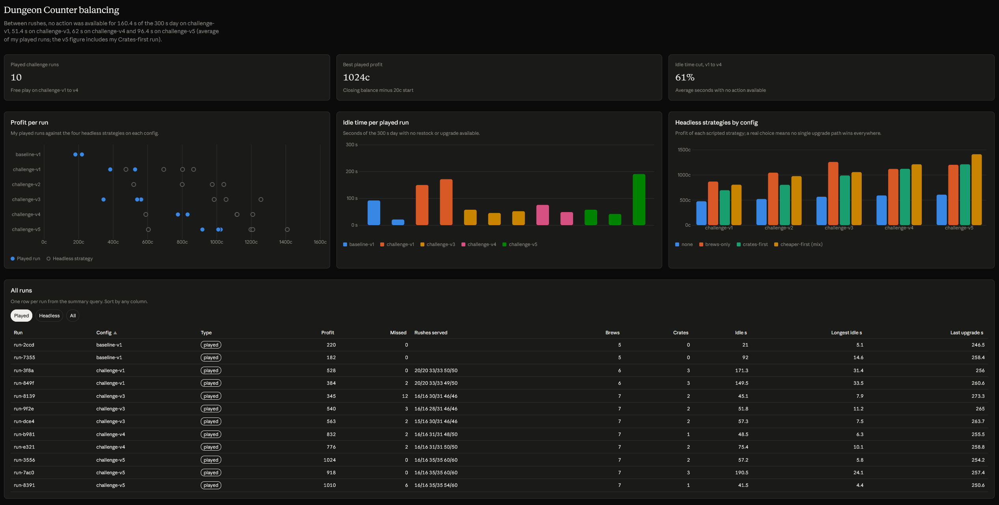

# Dungeon Counter — case-study notes

A five-minute potion-shop game for the browser, built in about three days with AI assistance, then redesigned when my own playtests showed the first version had nothing to decide. These notes collect the facts for a portfolio write-up; the full record is `docs/buildlog.md`.

## Disclosure

- **Fictional client.** Pocket Lantern Games and its founder Nico are invented. The brief (`docs/BRIEF_dungeon-counter-idle-sim.md`) is a self-set exercise, not a commission.
- **AI-assisted development.** Claude Code (Anthropic) wrote the code, tests, SQL and most documents at my direction, proposed the first economy numbers (`baseline-v1`, `challenge-v1`) without simulating them, and ran the headless strategy comparisons. I set the direction, playtested, made the design calls and wrote two configs by hand. The build log tags every decision as mine, proposed by Claude Code and accepted by me, or Claude Code's own implementation call.
- **Human-made art.** All sprites are CC0 tiles by Kenney (Roguelike/RPG Pack, Roguelike Characters), credited per file in `CREDITS.md`. No AI-generated images.
- **Testing actually performed.** One player (me): 12 complete played runs with exported event logs (2 on the original idle loop, 10 on the challenge configs), including a phone smoke test. Browser behaviour was also checked by automated scripts in headless Chrome. 214 unit tests cover the economy, scheduling, save/resume, CSV export and config selection. No external playtesters.

## Brief and deviations

The brief asked for a five-minute shop sim with one upgrade track, an AI-proposed baseline compared against a revised economy using real CSV event logs, one SQL aggregation and a balancing sheet, in about two days.

- **Time box:** about three days (18–24 hours), one day over the brief, as planned from the start.
- **Two upgrade tracks instead of one** (Better Brews and Bigger Crates): a single track offered no investment choice.
- **Medals and an interactive dashboard**, both listed as stretch goals, were built.

## What happened

1. **Built to plan.** A Phaser + TypeScript idle sim: restock potions, customers buy them, buy a price upgrade. Pure TypeScript economy, deterministic schedule, save/resume, CSV export, deployed on Cloudflare Pages.
2. **Playtest review, then a pivot.** After several rounds I wrote: "The five-minute loop is essentially restock → wait for sales → upgrade → repeat. There's some optimization involved, but very little meaningful decision-making, challenge or replay motivation." My two complete runs agreed: both served 100 of 100 customers with 20 restocks and ended at the same upgrade level. I stopped the planned analysis and redirected the project to a shop-management challenge: predictable customer rushes, competing upgrades, net profit as the score and a personal best.
3. **A missing constraint, caught before code.** Claude Code's impact review pointed out that with instant restocking a rush would be a free bonus, so the pivot gained a restock cooldown.
4. **Five economy versions, each driven by play.** The original idle config was kept frozen and playable as a git tag.

| Config | Change | Why | Who |
|---|---|---|---|
| `challenge-v1` | Rushes, cooldown, Bigger Crates, profit score | The pivot | Numbers proposed by Claude Code, frozen |
| `challenge-v2` | Calm stretches speed up through the day | "the game between the rush sections feels slow" | My direction |
| `challenge-v3` | Faster calm stretches, gentler rushes | Still slow on v2 | My hand-made config |
| `challenge-v4` | Calm speed-up 0.67, last rush 0.6 s | My tunes; the headless check showed they alone ended Better Brews' dominance | My tunes, chosen over Claude Code's candidate changes |
| `challenge-v5` | Faster rushes 2 and 3, medals | Make the upgrade choice noticeable to a player | Picked from Claude Code's headless comparison |

## Evidence highlights

Numbers come from `balancing/summary.sql` over the exported runs (`balancing/balancing-table.md`).

- **The slow stretches went away.** No action was available for 149.5 s and 171.3 s of the 300 s day on v1; on v3 to v5 it was 41.5–75.4 s, and the longest wait fell from about 32 s to 4–11 s (except my deliberate Crates-first run, below).
- **The score now depends on play.** The idle loop gave the same result every time; across the challenge runs profit ranges from +345c to +1024c and missed sales from 0 to 12.
- **Not every gain was a design gain.** About two thirds of v4's profit rise over v3 came from v4 having more customers, and one third from how I played, practice included.
- **The model can predict what a player will feel, if you read the right number.** On v5 I deliberately went Crates first and felt I "could do very little other than restock and wait for money" after the second rush. The data shows why: 190.5 s of that day had no action available (other v5 runs: 41.5 s and 57.2 s), because a 14-potion crate needs the shelf down to 6 potions before the next restock. The headless strategies had already shown the long idle time for Crates players; I had only compared their profits.

## What I would do next

- Shrink the largest crate (Crates +2 per level, largest crate 11), the candidate fix for the Crates-first dead stretch.
- Test with other players; every played run here is mine.

**Left out on purpose:** a hint when an upgrade can no longer pay for itself. My last upgrade came in the final minute of every challenge run, where it barely pays back under the profit score. I decided against the hint: "deliberately want to leave it out. dont want to spoon feed everything to players". Working out when to stop investing is part of the game.

## Where things are

- Play: https://dungeon-counter.pages.dev/ (default config `challenge-v5`; `?config=baseline` plays `challenge-v1`).
- Design: `docs/GDD-dungeon-counter-v4.md` (v1–v3 kept for provenance).
- Evidence: `balancing/runs/`, `balancing/summary.sql`, `balancing/balancing-table.md`, `balancing/notes.md`, and the "Dungeon Counter balancing" dashboard (claude.ai artifact; screenshot in `docs/dungeon-counter-dashboard-example.png`).
- Process: `docs/buildlog.md`.
